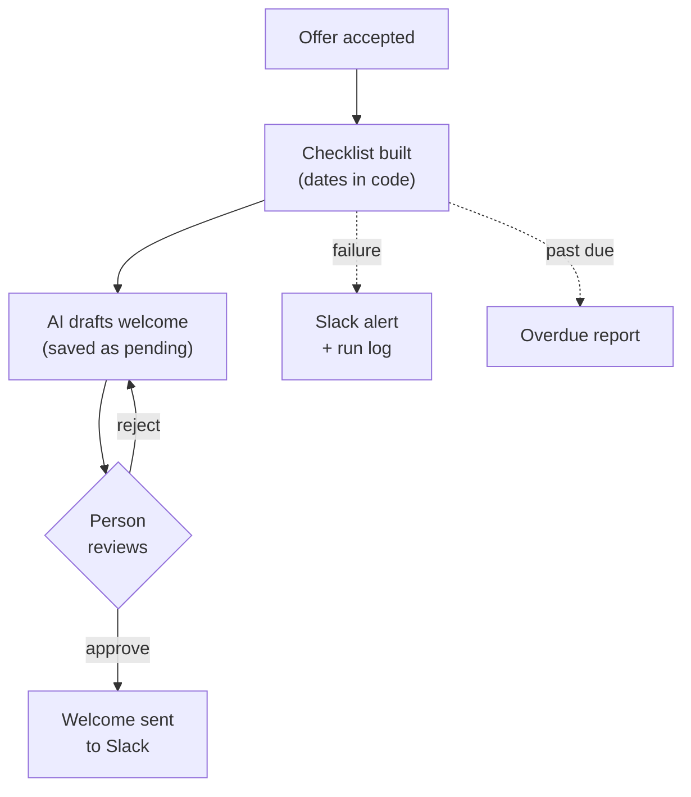

# Onboarding Agent

When a new hire accepts their offer, this agent starts onboarding right away: it creates the checklist with owners and due dates, drafts a first-week plan that the manager approves, posts a welcome in Slack, and flags anything overdue.

> Juniper Labs and everyone in `data/` are fictional. No real employee data.

**Live dashboard:** <https://nashmahler.github.io/onboarding-agent/> (a static page rebuilt from the demo database after every button click; it never calls an API and shows no emails or secrets).

## How it flows



Nothing reaches the new hire until a person approves. A rejected draft is saved with its reason and the next run drafts a fresh one.

## The rules and how each is enforced

| Rule | Where it is enforced |
|---|---|
| **A person approves anything sent to a person.** | `send_approved` flips `approved -> sent` in one SQL statement that only matches an approved row. A database trigger refuses any other route to `sent`, even a hand edit with the `sqlite3` tool. |
| **Dates, counts and "overdue" come from code, never the model.** | Due dates are computed in Python; overdue, day-one and per-owner counts are SQL in [queries/](queries/). The model only writes the plan text. |
| **Every run is logged.** | `log_run` writes a `runs_log` row for each step before anything else happens. |
| **A failed step alerts someone.** | `log_run` raises the Slack alert for every `failed` row, so no failure can be logged without one. If the alert can't be delivered, a failed `slack alert` row is written. A given bad event file alerts only the first time; later failures are logged as `already alerted` and post nothing. |
| **At most 3 Claude calls per new hire.** | Each call reserves a `runs_log` row in one SQL statement that inserts only while fewer than 3 exist. A 4th is refused before any request is made. |
| **No secrets in the repo.** | Keys live in a local `.env` or GitHub Actions secrets. The Slack URL is never printed or logged. Tests can't reach Slack or Claude (a global fixture makes any HTTP request raise). |

## How to run

```bash
pip install -r requirements.txt
python -m pytest
python -m onboarding_agent load data/sample_events
```

### Draft, approve, send

```bash
python -m onboarding_agent draft cand_1001
python -m onboarding_agent approve 1 --by "Eli Moss"      # or: reject 1 --by "Eli Moss" --reason "..."
python -m onboarding_agent send 1
```

`draft` writes a first-week plan and saves it as `pending`; nothing is sent. Only `approve` (by a named person) lets `send` deliver it, and `send` refuses anything that is pending, rejected or already sent. The plan comes from one Claude call using the key in `ONBOARDING_API_KEY` (set it in a local `.env` or your shell; never commit it). Without a key, a clearly labeled sample plan is saved instead. Delivery goes to Slack, or prints to the console if no webhook is set. See a real result in [examples/first_week_plan_maya.md](examples/first_week_plan_maya.md).

`load` reads every offer-accepted event in the folder, adds the new hire, and creates their onboarding tasks in a local SQLite file (`onboarding.db`, or pick one with `--db`). Running it again creates no duplicates. It prints one line per event, writes each result to `runs_log`, and exits with code 1 if any event failed (the sample folder includes one bad event on purpose).

### Finish a task, measure, and build the dashboard

```bash
python -m onboarding_agent complete cand_1001 --task "Add to payroll" --by "Pat"   # date set by the code
python -m onboarding_agent metrics                                                 # days to day-one done, overdue by owner
python -m onboarding_agent dashboard --out docs/index.html
```

## Slack

Set `ONBOARDING_SLACK_WEBHOOK` (an incoming-webhook URL) in your shell or a local `.env`; never commit it. Without it, every message prints to the console instead, so nothing here needs Slack to run.

| When | Message |
|---|---|
| A draft is saved | "Plan pending approval #N" with the hire, manager and the draft, labeled as not yet sent |
| `send` / `approve --send` on an approved draft | "Welcome to Juniper Labs, <name>" with the approved plan and the approver's name |
| Any step is logged as `failed` (first time per event file) | "Step failed: <step>" with the reason. The `runs_log` row is written first |
| `reject` | "Plan #N rejected by NAME: REASON" |
| `complete` | A short "task done" note with who marked it |
| `overdue --post` | The overdue report |

## Metrics (all SQL)

- **Days from offer accepted to all day-one tasks done** ([queries/days_to_day_one_done.sql](queries/days_to_day_one_done.sql)). A day-one task is one due on or before the start date. A hire shows "not yet" until every day-one task is done.
- **Overdue tasks by owner** ([queries/overdue_by_owner.sql](queries/overdue_by_owner.sql), plus [queries/overdue_tasks.sql](queries/overdue_tasks.sql) for the task list). A task is overdue when it is open and its due date is before today. Python picks "today" and passes it in.

## The buttons (GitHub Actions)

Add two repo secrets (Settings > Secrets and variables > Actions): `ONBOARDING_API_KEY` and `ONBOARDING_SLACK_WEBHOOK`. Then, under the Actions tab:

1. **Run onboarding**: loads `data/sample_events` and drafts a plan per hire (each posts "pending approval" to Slack). `cand_1005` is the planted failure: it is missing a start date, so it logs a failed row and posts an alert the first time. The run is green when every failure was logged and alerted; it goes red only for something unexpected (a crash, or an alert that could not be delivered).
2. **Approve**: inputs are the approval id (from the Slack message) and your name. It approves and sends the welcome to Slack.
3. **Reject**: inputs are the approval id, your name and a reason. It rejects a pending draft, saves the reason, and posts it to Slack. The next **Run onboarding** drafts a fresh plan for that hire (still within the 3-call cap).
4. **Overdue report**: posts the report to Slack.
5. **Complete task**: inputs are the candidate id, the exact task name and your name. It sets the completed date in code, logs it and posts a short note to Slack.

Every button then rebuilds `docs/index.html` and commits it together with the database.

**Where the database lives between runs:** a runner starts empty every time, so the SQLite file is committed to the repo at `data/demo/onboarding_demo.db`. Each workflow saves it back to `main` as `github-actions[bot]`, and the next run starts from it. The buttons share one concurrency group so two runs can't overwrite each other.

**Publishing the dashboard:** Settings > Pages > Build and deployment > Source: *Deploy from a branch* > Branch: `main`, folder `/docs` > Save.

## Known gaps

- **Holidays.** Due dates skip weekends but not public holidays, so a task can land on a day nobody is working.
- **Changed start dates are ignored.** If an offer-accepted event is replayed with a different start date, the existing employee and task due dates are kept (the inserts use `ON CONFLICT DO NOTHING`). It needs its own handling: update the employee and recompute due dates for tasks not yet done.
- **Retrying a failed send is manual.** If an approved plan fails to send (for example Slack is down), it goes back to `approved`; someone has to run `python -m onboarding_agent send <id>` against the pulled database.
- **The approver name is typed.** Whoever clicks Approve, Reject or Complete types their own name, so the real control is who has write access to the repo.
- **Task completion is by exact name.** A typo is refused (and the valid names are listed), but there is no picker.

## What broke and how I fixed it

- **A reply cut off mid-plan was treated as fine.** Claude hit `max_tokens` and the half-written draft was saved as pending. Now a reply that stops at the limit is logged as failed, no approval row is saved, and `max_tokens` is higher.
- **A rejected draft blocked any new one.** After a rejection `draft` refused to make another. A new draft is now allowed after a rejection, with the 3-calls-per-hire cap counted in SQL so failed calls still use a slot.
- **The draft invented a job title for the manager.** A reviewer rejected plan 4 for it (the reason is saved and shown on the dashboard). I tightened the prompt: sign with the manager's name only, no invented titles, meetings or tools.
- **A queued workflow run read an old database.** A button clicked while another was running checked out the commit that was `main` at click time, so it missed the previous run's changes. The workflows now check out the latest `main`, and share one concurrency group.
- **Alerts repeated forever for the same bad file.** `cand_1005` alerted on every run. Now only the first failure of a given event file posts to Slack. If that first alert never reached Slack, the next failure alerts again.

## Status

Week 4 of my weekly builds. See [BUILD_PLAN.md](BUILD_PLAN.md).

More builds at [nashmahler.github.io/builds](https://nashmahler.github.io/builds).
